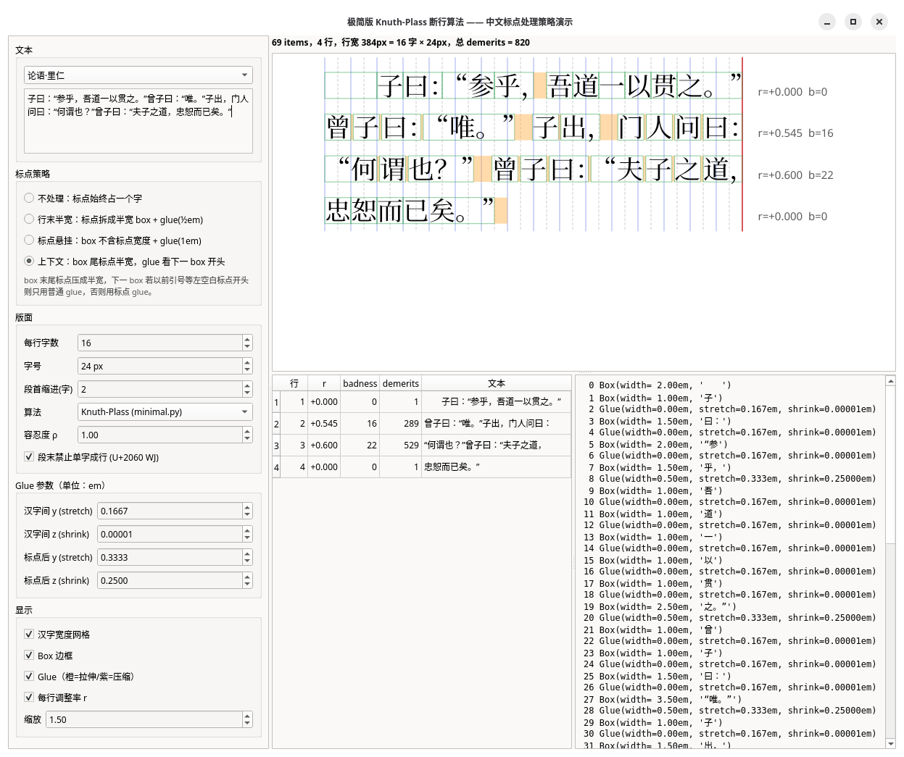

# Knuth-Plass line-breaking algorithms in Python.

Here are several simplified implementations of the Knuth-Plass line-breaking algorithm, as described in the Knuth-Plass 1981 paper:

Donald E. Knuth, Michael F. Plass. "[Breaking paragraphs into lines](https://gwern.net/doc/design/typography/tex/1981-knuth.pdf)", _Software - Practice and Experience_, **11** (1981), 1119–1184.
Reprinted with corrections as Chapter 3 of [_Digital Typography_](https://www-cs-faculty.stanford.edu/~knuth/dt.html) (Donald E. Knuth. CSLI Lecture Notes No. 78, 1999).

Files

* `sample.py` provides the sample paragraph used in Knuth-Pass 1981 paper, with font metrics provided in _Digital Typography_ Chapter 3.
* `minimal.py` implements the simplest version of Knuth-Plass, no hyphenation or penalty, only box and glue.
   This is approximately equivalent to the stripped-down version from the appendix of Knuth-Plass 1981 paper, but without hyphenation.
    * `render_minimal.py` reproduces the result of Figure 4 (c) in Knuth-Plass 1981 paper.
    * `minimal_chinese_demo.py` demos Chinese punctuation width adjustments.
    * `minimal_dp.py` is the same model as `minimal.py`, written as a textbook DP over an array.
* `basic.py` implements a basic version of Knuth-Plass, supporting Box, Glue, and Penalty.
   No double hyphen demerits, no fit classes, no looseness, etc.
    *  `render_basic.py` reproduces the result of Figure 3 in Knuth-Plass 1981 paper.
* `simple.py` extends `basic.py` for Chinese text: glue and penalties after a break are discarded,
   line widths may vary from line to line, and looseness is supported. Ties go to the later breakpoint.
   Still no double hyphen demerits or fit classes.
    * `render_paragraph.py` renders a paragraph of Chinese or mixed Chinese/Latin text into a PDF or PNG,
      with `--text_widths` and `--looseness`.
* `full.py` follows "The Algorithm Itself" of the paper: flagged penalties (double hyphen demerits),
   fitness classes, varying line widths and looseness.



Formulas

* Adjustment ratio $r$, $-1\le r \le \mathrm{max\_stretch}$
* Badness $b=\lfloor 100 \cdot |r|^3 \rfloor$
* Demerits $d=(l+b)^2\pm p^2$, where $l$ is line penalty, $l=1$ in the original paper, $l=10$ in TeX82, $p$ is penalty.

## Comparison of `basic.py`, `simple.py` and `full.py`

All three take the same items (`Box`, `Glue`, `Penalty` from `common.py`), use the same ratio, badness and demerits,
and return a list of `LineBreakResult`.

```python
basic.line_break(items, line_width, max_stretch_ratio=1.0, final_pass=False)
simple.line_break(items, line_widths, max_stretch_ratio=1.0, looseness=0, final_pass=False)
full.line_break(items, line_widths, max_stretch_ratio=1.0, looseness=0, final_pass=False)
```

| | `basic.py` | `simple.py` | `full.py` |
|---|---|---|---|
| Line widths | one width | one width, or a list whose last width repeats | same as `simple.py` |
| Looseness | no | yes | yes |
| Items discarded after a break | the break item only; further glue belongs to the next line | all glue and penalties up to the next box | same as `simple.py` |
| Fitness classes, $\gamma=3000$ | no | no | yes |
| Double hyphen demerits, $\alpha=3000$ | no | no | yes |
| Final pass (sets an overfull line instead of failing) | yes | yes | yes, the overfull line is charged no $\alpha$ or $\gamma$ |
| Breakpoints kept at a position | the best one | the best one per line number; a single one if all widths are equal and looseness is 0 | the best one per line number and fitness class, if within $\gamma$ of the best for that line number |
| Ties | `<`, the earlier predecessor wins | `<=`, the later one wins, like TeX | `<=` |
| Infeasible line at a forced break | competes with feasible lines, at badness 10000 | used only if there is no feasible line | same as `simple.py` |
| `start` of a line in the result | right after the previous break | the first box of the line | the first box of the line |
| End of paragraph required | infinite glue, then `Penalty.EJECT` | same as `basic.py` | `Penalty.EJECT` only |
| Tracing | `basic.TRACE` | `simple.TRACE` | no |
| Statistics | no | no | `line_break.max_active`, `line_break.total_demerits` |
| Tests | `basic_test.py` | `simple_test.py` | `full_test.py` |
| Used by | `render_basic.py` | `render_paragraph.py` | |

When they agree:

* `simple.py` finds the same total demerits as `basic.py` for a single line width and no looseness,
  as long as no break is followed by further glue or penalties, and neither of them sets an infeasible line
  at a forced break. The breaks may still differ where there are ties.
* `full.py` finds the same total demerits as `simple.py` when $\alpha=\gamma=0$.

Which one to use:

* `basic.py` is the shortest, for reading along with the paper.
* `simple.py` is meant for Chinese text. There is no hyphenation, so $\alpha$ does not matter, but lines often
  cannot be set without the final pass, and looseness can remove a last line of one or two characters.
* `full.py` is for Latin text with hyphenation, where $\alpha$ and $\gamma$ make a visible difference.

## Other implementations


