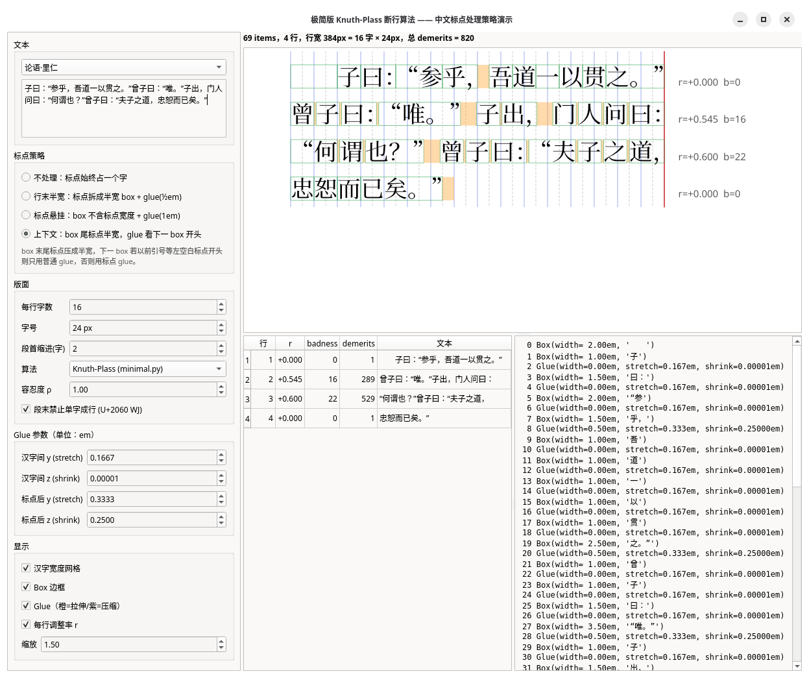

# Knuth-Plass line-breaking algorithms in Python.

Here are several simplified implementations of the Knuth-Plass line-breaking algorithm, as described in the Knuth-Plass 1981 paper:

Donald E. Knuth, Michael F. Plass. "[Breaking
paragraphs into lines](https://gwern.net/doc/design/typography/tex/1981-knuth.pdf)", _Software - Practice and
Experience_, **11** (1981), 1119–1184.
Reprinted with corrections as Chapter 3 of [_Digital Typography_](https://www-cs-faculty.stanford.edu/~knuth/dt.html) (Donald E. Knuth. CSLI Lecture Notes No. 78, 1999).

Files

* `sample.py` provides the sample paragraph used in Knuth-Pass 1981 paper, with font metrics provided in _Digital Typography_ Chapter 3.
* `minimal.py` implements the simplest version of Knuth-Plass, no hyphenation or penalty, only box and glue.
   This is approximately equivalent to the stripped-down version from the appendix of Knuth-Plass 1981 paper, but without hyphenation.
    * `render_minimal.py` reproduces the result of Figure 4 (c) in Knuth-Plass 1981 paper.
    * `minimal_chinese_demo.py` demos Chinese punctuation width adjustments.
* `basic.py` implements a basic version of Knuth-Plass, supporting Box, Glue, and Penalty.
   No double hyphen demerits, no fit classes.
    *  `render_basic.py` reproduces the result of Figure 3 in Knuth-Plass 1981 paper.

Formulas

* Adjustment ratio $r$, $-1\le r \le \mathrm{max\_stretch}$
* Badness $b=\lfloor 100 \cdot |r|^3 \rfloor$
* Demerits $d=(l+b)^2\pm p^2$, where $l$ is line penalty, $l=1$ in the original paper, $l=10$ in TeX82, $p$ is penalty.

## Other implementations

